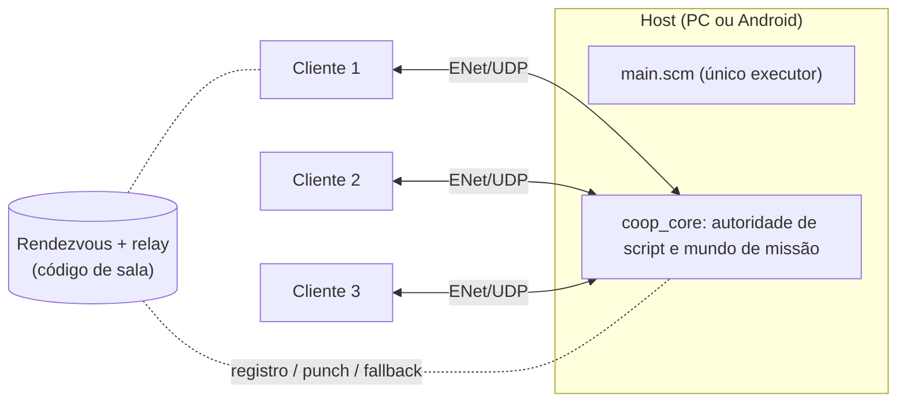
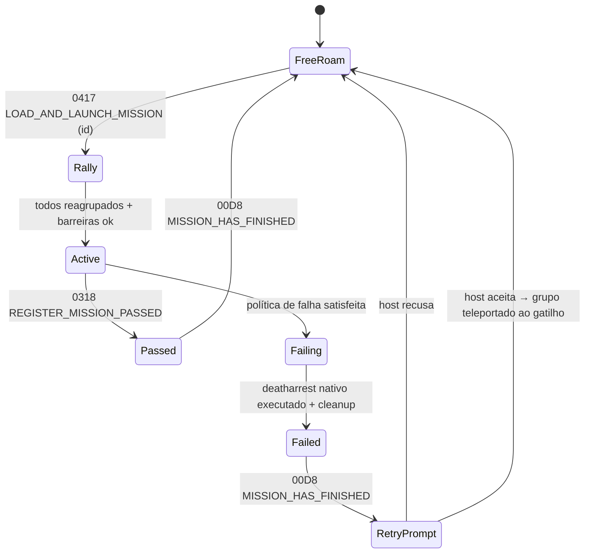

# GTA:SA Coop — Documento de Arquitetura de Software (SAD)

Modo cooperativo Online/LAN para até 4 jogadores na campanha do *Grand Theft Auto: San Andreas*
(PC 1.0 US e Android 2.x), sem carregadores de mods, com cross-play PC ↔ Android.

> **Convenções deste documento**
> - Endereços `0x…` referem-se ao `gta_sa.exe` **1.0 US**. Eles vêm da documentação pública da
>   comunidade (gta-reversed, plugin-sdk) e **devem ser conferidos contra o gta-reversed antes de
>   virar código**; só os usados em `platform/win32/Addresses.h` fazem parte do scaffold atual.
> - No Android os alvos são resolvidos por **símbolo** (`dlsym`), pois a `libGTASA.so` exporta os
>   nomes C++; assinaturas marcadas "a confirmar" precisam ser checadas no binário.
> - ✔ = existe neste repositório e compila/testa no CI · ○ = planejado (ver [ROADMAP](ROADMAP.md)).

---

## 0. Decisões centrais e gargalos da engine

O San Andreas foi escrito como jogo single-player sobre a RenderWare. A RenderWare em si (RwFrame,
RpClump, RpHAnim) é quase irrelevante para o problema — ela só impõe que **tudo que toca o mundo
rode na thread do jogo**. Os gargalos reais estão na camada de jogo da Rockstar:

| # | Gargalo | Por que quebra o coop | Solução adotada |
|---|---|---|---|
| G1 | **Jogador único implícito**: `FindPlayerPed(-1)`, `CWorld::PlayerInFocus`, `CWorld::Players[2]`, `CPad::GetPad(0)` espalhados por centenas de funções | Um `CPlayerPed` remoto processado normalmente lê o controle e a câmera do jogador local | `Players[]` realocado para 4 slots + **troca de contexto** em torno de `CPlayerPed::ProcessControl` (§4.2) |
| G2 | **Pools fixos e handles locais**: handle de script = `(índice << 8) \| flags`; 140 peds, 110 veículos | O mesmo ped tem handle diferente em cada peer; nada baseado em handle pode trafegar | `NetId` de 16 bits + `HandleMap` na borda (§4.1, ✔ `src/core/script/HandleMap.h`) |
| G3 | **Streaming centrado em uma câmera**: modelos (`CStreaming`) e colisão (`CColStore`) só existem perto do jogador local | Entidade de missão longe do host cai pelo mapa ou fica congelada esperando colisão | **Migração de propriedade**: cada entidade é simulada pelo peer mais próximo (*syncer*); o host mantém apenas um proxy (§4.4) |
| G4 | **`main.scm` é bytecode cooperativo com "player 0" implícito**, ~1.400 opcodes em uso, lógica baseada em `WAIT` e polling | Rodar o script em 4 máquinas diverge em segundos (RNG, timing, streaming) | **Só o host executa bytecode.** Os clientes recebem entidades replicadas + RPC de opcodes classificados (§5) |
| G5 | **Física dependente do passo de tempo** (`CTimer::ms_fTimeStep`), x87 no PC vs NEON no ARM | Lockstep determinístico é impossível | Sincronização **por estado** com autoridade por entidade, nunca por entradas; fio em ponto fixo (§6) |
| G6 | **A versão mobile não é a versão PC recompilada**: front-end diferente (sem `CMenuManager` de PC), `main.scm` diferente (checkpoints), layout de structs diferente, save diferente | Qualquer coisa que suponha paridade binária PC↔Android falha | Núcleo portável sem headers do jogo + camada `platform/*` com tabelas de layout; estado de mundo trafega em formato neutro (§5.8, §6) |

Consequência arquitetural: **host autoritativo para script e mundo de missão; cada peer autoritativo
para o próprio jogador e para as entidades de que é *syncer***. Não há simulação determinística em
lugar nenhum.

---

## 1. Estrutura do repositório e build system

### 1.1 Árvore de diretórios

```
.
├── CMakeLists.txt                  ✔ build unificado (Win32 x86 / Android / host)
├── README.md                       ✔
├── LICENSE                         ✔ MIT
├── cmake/
│   └── toolchain-mingw-i686.cmake  ✔ cross-compile da DLL a partir de Linux
├── include/coop/                   ✔ API pública do núcleo
│   ├── Version.h                   ✔ versão de protocolo, limites
│   └── Math.h                      ✔ Vec3/Quat/lerp/nlerp
├── src/core/                       núcleo portável — proibido incluir headers do jogo ou do SO
│   ├── Runtime.{h,cpp}             ✔ ponto de entrada por frame
│   ├── net/
│   │   ├── ByteStream.h            ✔ serialização LE explícita, leitura à prova de truncamento
│   │   ├── Quantize.h              ✔ ponto fixo: posição, velocidade, quaternion smallest-three
│   │   ├── Protocol.h              ✔ canais, mensagens, PlayerSnapshot
│   │   ├── Transport.{h,cpp}       ✔ wrapper ENet
│   │   ├── TimeSync.{h,cpp}        ○ relógio de sessão (offset por RTT mínimo)
│   │   ├── Discovery.{h,cpp}       ○ broadcast LAN
│   │   └── Rendezvous.{h,cpp}      ○ código de sala, hole punching, relay
│   ├── sync/
│   │   ├── SnapshotBuffer.{h,cpp}  ✔ interpolação / extrapolação limitada
│   │   ├── EntityRegistry.{h,cpp}  ○ NetId, propriedade, escopo de relevância
│   │   ├── PlayerSync.{h,cpp}      ○
│   │   ├── VehicleSync.{h,cpp}     ○
│   │   ├── PedSync.{h,cpp}         ○ população ambiente
│   │   └── CombatSync.{h,cpp}      ○ tiros, dano, projéteis, explosões
│   ├── script/
│   │   ├── OpcodePolicy.{h,cpp}    ✔ classificação de opcodes (tabela-semente)
│   │   ├── HandleMap.h             ✔ NetId ↔ handle local
│   │   ├── ScriptReplicator.{h,cpp}○ host: captura de opcodes → RPC
│   │   ├── ScriptExecutor.{h,cpp}  ○ cliente: validação + execução nativa
│   │   ├── MissionState.{h,cpp}    ○ máquina de estados de missão, falha/reinício
│   │   └── PartyPolicy.{h,cpp}     ○ protagonista, quantificadores, papéis
│   └── ui/
│       └── LobbyModel.{h,cpp}      ○ estado do lobby (independente de renderização)
├── platform/
│   ├── common/
│   │   ├── IGame.h                 ○ interface que o núcleo usa para falar com o jogo
│   │   └── Hook.h                  ○ fachada de hook (MinHook | ShadowHook/Dobby)
│   ├── win32/
│   │   ├── dllmain.cpp             ✔ proxy dinput8 + hook de CGame::Process + snapshot local
│   │   ├── dinput8.def             ✔
│   │   ├── Addresses.h             ✔ único lugar com endereços do 1.0 US
│   │   ├── GameWin32.cpp           ○ implementação de IGame
│   │   └── MenuWin32.cpp           ○ integração com CMenuManager
│   └── android/
│       ├── entry.cpp               ✔ JNI_OnLoad + resolução por símbolo
│       ├── Layout_armv7.h          ○ offsets de structs (2.00/2.10 armeabi-v7a)
│       ├── Layout_arm64.h          ○ offsets de structs (2.10 arm64-v8a)
│       ├── GameAndroid.cpp         ○ implementação de IGame
│       └── MenuAndroid.cpp         ○ integração com o front-end mobile
├── data/
│   ├── opcodes.json                ○ assinatura + classe de cada opcode (fonte da tabela gerada)
│   └── missions.json               ○ papéis e política por missão
├── tools/
│   ├── opgen/                      ○ gera OpcodeTable.inc a partir de data/opcodes.json
│   ├── apk-patcher/                ○ injeta a .so e a chamada loadLibrary no APK do usuário
│   └── rendezvous/                 ○ servidor de salas/relay (UDP, auto-hospedável)
├── tests/
│   └── test_core.cpp               ✔ serialização, quantização, interpolação, tabela, loopback ENet
├── third_party/README.md           ✔ dependências e versões fixadas
├── docs/
│   ├── ARCHITECTURE.md             ✔ este documento
│   └── ROADMAP.md                  ✔ milestones e issues
└── .github/workflows/build.yml     ✔ CI: testes + DLL (MSVC e MinGW) + .so (2 ABIs) + release
```

Regra de dependência (imposta pelo CMake — `coop_core` não recebe nenhum include de `platform/`):

```
platform/win32 ──┐
                 ├──► src/core ──► ENet
platform/android ┘        ▲
                          └── tests (host)
```

### 1.2 `CMakeLists.txt` raiz

O arquivo real está na raiz do repositório; os pontos que importam:

```cmake
if(ANDROID)       set(COOP_PLATFORM android)
elseif(WIN32)     set(COOP_PLATFORM win32)
  if(NOT CMAKE_SIZEOF_VOID_P EQUAL 4)       # gta_sa.exe é 32 bits: recusa build x64
    message(FATAL_ERROR "... cmake -A Win32 ...")
  endif()
else()            set(COOP_PLATFORM host)   # núcleo + testes
endif()

# Ponto flutuante reprodutível entre x86 e ARM (§6)
#   MSVC : /fp:precise /arch:SSE2
#   GCC  : -fno-fast-math -ffp-contract=off  (+ -msse2 -mfpmath=sse em x86)

FetchContent_Declare(enet    GIT_TAG v1.3.18 ...)   # todas as plataformas
FetchContent_Declare(minhook GIT_TAG v1.3.4  ...)   # só win32

add_library(coop_core STATIC ...)                   # portável

add_library(coop_win32 SHARED platform/win32/dllmain.cpp platform/win32/dinput8.def)
set_target_properties(coop_win32 PROPERTIES OUTPUT_NAME dinput8 PREFIX "")   # -> dinput8.dll

add_library(GTASA_Coop SHARED platform/android/entry.cpp)                    # -> libGTASA_Coop.so
target_link_options(GTASA_Coop PRIVATE -Wl,--exclude-libs,ALL -Wl,-z,max-page-size=16384)
```

Detalhes não óbvios:

- **CRT estática** (`/MT` via `CMAKE_MSVC_RUNTIME_LIBRARY`, `-static` no MinGW): a DLL não pode exigir
  o VC++ Redistributable. A DLL gerada só importa `KERNEL32`, `msvcrt`, `WINMM` e `WS2_32`.
- **`max-page-size=16384`**: dispositivos Android 15+ com páginas de 16 KB recusam `.so` alinhada a 4 KB.
- **`--exclude-libs,ALL` + visibilidade oculta**: a `.so` só exporta `JNI_OnLoad`; nenhum símbolo do
  ENet colide com o que a `libGTASA.so` já carrega.

Comandos:

```bash
# Núcleo + testes (qualquer SO)
cmake -S . -B build && cmake --build build && ctest --test-dir build

# Windows x86 — MSVC
cmake -S . -B build -A Win32 && cmake --build build --config Release

# Windows x86 — MinGW (Linux/MSYS2)
cmake -S . -B build -DCMAKE_TOOLCHAIN_FILE=cmake/toolchain-mingw-i686.cmake -DCMAKE_BUILD_TYPE=Release
cmake --build build

# Android (repetir para armeabi-v7a)
cmake -S . -B build -DCMAKE_TOOLCHAIN_FILE=$ANDROID_NDK/build/cmake/android.toolchain.cmake \
      -DANDROID_ABI=arm64-v8a -DANDROID_PLATFORM=android-24 -DANDROID_STL=c++_static
cmake --build build
```

### 1.3 CI/CD — `.github/workflows/build.yml`

| Job | Runner | Produz |
|---|---|---|
| `core-tests` | ubuntu | build com `-Werror` + `ctest` (inclui loopback ENet real) |
| `windows-msvc` | windows | `dinput8.dll` (artefato de release) |
| `windows-mingw` | ubuntu | valida o caminho de cross-compile e a exportação `DirectInput8Create` |
| `android` (matriz 2 ABIs) | ubuntu + NDK do runner | `libGTASA_Coop.so` |
| `release` | ubuntu | em `release: published`, anexa `…-windows-x86.zip`, `…-android.zip` e `SHA256SUMS.txt` |

O job `release` é o único com `contents: write`; os demais rodam com token somente-leitura.

---

## 2. Arquitetura geral e stack tecnológica

### 2.1 Carregamento sem mod loaders

**PC.** O `gta_sa.exe` importa estaticamente `DINPUT8.dll!DirectInput8Create`. `dinput8` não está em
*KnownDLLs*, então o loader do Windows procura primeiro na pasta do executável. Entregamos um
`dinput8.dll` que (1) encaminha `DirectInput8Create` para o `dinput8.dll` de `System32`/`SysWOW64` e
(2) instala os hooks no `DLL_PROCESS_ATTACH` (✔ `platform/win32/dllmain.cpp`).

Por que `dinput8` e não `vorbisFile.dll`: `vorbisFile.dll` é um arquivo **do jogo** (seria preciso
sobrescrever/renomear o original e reexportar ~30 funções); `dinput8` não substitui nada — instalar
é copiar um arquivo, desinstalar é apagá-lo. No Linux (Wine/Proton) basta
`WINEDLLOVERRIDES="dinput8=n,b"`.

Só o executável **1.0 US** é aceito (sonda `*(uint32*)0x82457C == 0x94BF`); em qualquer outro o coop
se desativa e o jogo roda normalmente. Suportar 1.01/Steam/RGL exigiria uma tabela de endereços por
versão — fora do escopo.

**Android.** Um APK não pode ser alterado sem ser reassinado, então "sem mods" aqui significa: o
usuário roda **uma vez** o `apk-patcher` sobre o **próprio** APK, que:

1. copia `libGTASA_Coop.so` para `lib/<abi>/`;
2. insere, no inicializador estático da Activity do jogo, `System.loadLibrary("GTASA_Coop")` logo
   após o `loadLibrary("GTASA")` (uma linha de smali);
3. realinha (`zipalign`) e reassina com uma chave local.

Quando nosso `JNI_OnLoad` roda, a `libGTASA.so` já está mapeada e relocada (✔ `platform/android/entry.cpp`).
Alternativa descartada: `patchelf --add-needed` na `libGTASA.so` — nosso construtor rodaria *antes*
da inicialização da biblioteca do jogo.

Limites honestos desta rota: a assinatura muda, logo o APK original precisa ser desinstalado
(backup dos saves antes) e o projeto **nunca distribui APK/OBB** — apenas o patcher e a `.so`.

**Reimplementação tipo re3/reVC** foi descartada como base: o gta-reversed ainda depende do
executável original e não existe decompilação utilizável da versão mobile. Ele é usado como
**documentação** de assinaturas e layouts.

### 2.2 Biblioteca de rede: ENet

| | ENet 1.3.x | SLikeNet/RakNet | GameNetworkingSockets |
|---|---|---|---|
| Tamanho / deps | ~6 kLOC C, zero deps | grande, legado | protobuf + OpenSSL/libsodium |
| NDK ARMv7/ARM64 | trivial | trabalhoso | viável, build pesado |
| Confiável + não confiável por canal | sim | sim | sim |
| NAT traversal embutido | não | sim (precisa servidor) | só com a infra Steam |
| Custo no binário x86 estático | ~40 KB | ~1 MB | vários MB |

Com 4 peers em estrela não precisamos de nada além de canais confiáveis/não confiáveis e
fragmentação — ENet cobre. O que ENet não tem (NAT, descoberta) é pequeno e fica em `src/core/net`.

Canais (✔ `Protocol.h`):

| Canal | Entrega | Conteúdo |
|---|---|---|
| 0 `Control` | confiável ordenado | handshake, lobby, `TimeSync`, baseline de mundo |
| 1 `Script` | confiável ordenado | **ciclo de vida de entidades de missão + RPC de opcodes + barreiras** |
| 2 `State` | não confiável sequenciado | snapshots de jogador/veículo/ped |
| 3 `Event` | confiável | tiros, dano, explosões, entrar/sair de veículo |

Entidades de missão e RPCs de script viajam **no mesmo canal ordenado** de propósito: um comando
nunca chega antes do `EntityCreate` de que depende (§5.4).

### 2.3 Topologia



Estrela com *listen server*: clientes só falam com o host, que retransmite snapshots. Só o host
precisa ser alcançável.

### 2.4 Conexão: LAN, IP direto, código de sala

1. **LAN** — o host responde a um broadcast UDP (porta 7778) com nome, jogadores e versão de
   protocolo. Zero digitação; é o caminho principal no Android.
2. **IP direto** — `ip[:porta]`, sempre disponível.
3. **Código de sala** (6 caracteres, base32 Crockford) — servidor de rendezvous minimalista:

```
Host ──REGISTER──────────────► Rendezvous      (observa ip:porta público do host)
Host ◄─────────ROOM "K7Q2MX"── Rendezvous
Cli  ──JOIN "K7Q2MX"─────────► Rendezvous      (observa ip:porta público do cliente)
Host ◄──PEER cli_ip:porta───── Rendezvous ────PEER host_ip:porta──► Cli
Host ──punch──► Cli    Cli ──punch──► Host     (mesmo socket UDP que o ENet usa)
Cli  ══ enet_host_connect(host_ip:porta) ═══► Host
```

Os pacotes de *punch* saem do **mesmo socket** do `ENetHost` (`enet_socket_send(host->socket, …)`),
senão o mapeamento NAT aberto não é o que o ENet usará. NAT simétrico/CGNAT (comum em redes móveis)
derrota o hole punching; após 3 s sem conexão o cliente cai para **relay** pelo próprio rendezvous
(encaminhamento opaco dos datagramas; o tráfego total da sessão fica abaixo de ~150 kbit/s). O
servidor é ~300 linhas, sem estado persistente, auto-hospedável; o endereço é configurável.

### 2.5 Modelo de threads

Tudo roda na **thread do jogo**: `Runtime::Frame()` chama `enet_host_service(…, 0)` (não bloqueante)
uma vez por frame, dentro do hook de `CGame::Process`. Nenhuma thread extra toca pools, RenderWare ou
scripts. `DllMain` só aplica patches de memória (está sob *loader lock*); sockets são abertos no
primeiro frame.

### 2.6 Segurança

- `ByteReader` nunca lê fora do buffer; mensagem truncada é descartada (✔ testado byte a byte).
- O cliente só executa RPC de opcodes cuja classe é `ReplicateFx`/`ReplicateTask` **na tabela dele**
  e só depois de validar todo parâmetro-handle (§5.4). Um host malicioso não consegue acionar
  opcodes arbitrários.
- Handshake rejeita magic/versão de protocolo diferentes; sala pode ter senha.

---

## 3. Engenharia da interface (menu cooperativo)

> **Correção de premissa.** `LD_PLAN` é um TXD de sprites de script (`models/txd/LD_PLAN.txd`) e
> `FE_HLP*`/`FEH_*`/`FEP_*` são **chaves de texto GXT**, não texturas. Os fundos e ícones do menu
> ficam em `fronten1/2/3.txd` e `fronten_pc.txd`. Usamos todos esses recursos, cada um no papel
> certo: fontes e fundo do front-end, textos via GXT, e sprites `LD_*` como ícones do lobby.

### 3.1 PC — `CMenuManager`

O front-end do PC é dirigido por dados: `CMenuManager::aScreens` (`0x8CE008`), 44 páginas de `0xE2`
bytes:

```cpp
#pragma pack(push, 1)
struct MenuEntry {            // 18 bytes
    uint8_t action;           // eMenuAction (ex.: trocar de página, novo jogo, sair)
    char    gxtKey[8];        // chave GXT do rótulo
    uint8_t type;             // tipo/slot de save
    uint8_t targetPage;       // página de destino
    uint8_t _pad;
    int16_t x, y;             // posição (base 640x448)
    uint8_t align;
    uint8_t _pad2;
};
struct MenuScreen {           // 0xE2 bytes
    char      titleKey[8];
    uint8_t   prevPage;
    uint8_t   parentEntry;
    MenuEntry entries[12];
};
#pragma pack(pop)
static_assert(sizeof(MenuScreen) == 0xE2);
```

**Passo 1 — entrada no menu principal (patch só de dados).** A página do menu principal usa 3 das
12 entradas ("Iniciar Jogo", "Opções", "Sair"). Inserimos a nossa logo após "Iniciar Jogo":

```cpp
void AddCoopEntry(MenuScreen* screens) {
    MenuScreen& main = screens[kPageMainMenu];              // índice a confirmar no gta-reversed
    std::memmove(&main.entries[2], &main.entries[1], sizeof(MenuEntry) * 10);
    MenuEntry& e = main.entries[1];
    e = {};
    e.action     = kActionSwitchPage;                       // mesma ação de "Opções"
    std::memcpy(e.gxtKey, "COOP_MN", 8);                    // "Cooperativo (1-4 Jogadores)"
    e.targetPage = kPageCoopRoot;                           // >= 44: página virtual
    // x/y = 0 e align herdado: DrawStandardMenus empilha as entradas automaticamente
}
```

**Passo 2 — textos sem editar `american.gxt`.** Hook em `CText::Get` (`0x6A0050`): chaves com
prefixo `COOP_` são servidas por uma tabela embutida (pt-BR, en, es…) escolhida pelo idioma atual do
jogo; qualquer outra chave segue para o original.

**Passo 3 — páginas virtuais.** `aScreens` tem tamanho fixo e é indexado por código *inline* em
dezenas de pontos; realocá-lo exigiria corrigir todas as referências. Em vez disso as páginas do
coop usam ids **≥ 44** e nunca chegam ao código nativo que indexa a tabela:

```cpp
void __fastcall Hook_DrawStandardMenus(CMenuManager* self, void*, bool drawTitle) {
    if (self->m_nCurrentMenuPage >= kPageCoopRoot) { CoopMenu::Draw(*self); return; }
    orig_DrawStandardMenus(self, drawTitle);
}
void __fastcall Hook_UserInput(CMenuManager* self, void*) {
    if (self->m_nCurrentMenuPage >= kPageCoopRoot) { CoopMenu::Input(*self); return; }
    orig_UserInput(self);
}
```

Funções a interceptar: `DrawStandardMenus` (`0x5794A0`), `UserInput` (`0x57FD70`),
`SwitchToNewScreen` (`0x573680`). Toda função que leia `aScreens[m_nCurrentMenuPage]` fora dessas
precisa ser auditada no gta-reversed e receber a mesma guarda (ex.: seleção de fundo em
`DrawBackground`); isso é um item explícito da Fase 2.

**Passo 4 — desenhar "igual ao jogo".** `CoopMenu::Draw` usa exatamente as primitivas do front-end:

```cpp
void CoopMenu::DrawItem(const char* gxt, float x, float y, bool selected) {
    CFont::SetBackground(false, false);
    CFont::SetProportional(true);
    CFont::SetFontStyle(FONT_MENU);                         // mesma fonte dos itens nativos
    CFont::SetScale(ScaleX(0.7f), ScaleY(1.0f));
    CFont::SetEdge(1);
    CFont::SetColor(selected ? kMenuSelected : kMenuItem);  // cores do HudColour do front-end
    CFont::PrintString(ScaleX(x), ScaleY(y), TheText.Get(gxt));
}
```

Título em `FONT_GOTHIC` no canto superior direito, fundo e cursor desenhados pelo fluxo nativo
(`DrawBackground` continua rodando), sons de navegação pelo mesmo `AudioEngine.ReportFrontendAudioEvent`.

**Fluxo de páginas:**

```
Menu principal
 └─ Cooperativo (1-4 Jogadores)
     ├─ Hospedar ──► [Novo jogo | Carregar save] ──► LOBBY (código K7Q2MX, IP LAN, 1/4)
     ├─ Entrar por código  ──► campo de 6 caracteres ──► LOBBY
     ├─ Entrar por IP      ──► campo de texto        ──► LOBBY
     └─ Partidas na LAN    ──► lista descoberta      ──► LOBBY
LOBBY: slots 1-4 (nome, plataforma, ping, pronto) · Host: Iniciar · Todos: Pronto / Sair
```

**Entrada de texto.** O front-end do PC não tem campo de texto. Capturamos `WM_CHAR` no `WndProc` do
jogo enquanto uma página com campo está ativa (e suprimimos a navegação do menu para essas teclas).
O código de sala usa alfabeto sem caracteres ambíguos e aceita colar (`Ctrl+V`).

**Início de sessão.** "Iniciar" no lobby dispara o fluxo nativo de novo jogo/carregar no host; os
clientes entram no mundo pelo mesmo caminho de "novo jogo", mas com scripts suprimidos e estado de
mundo vindo do baseline (§5.8).

### 3.2 Android

A versão mobile **não usa o front-end de PC**: o menu é uma hierarquia própria de telas
(`MobileMenu`, `MainMenuScreen`, …) com itens adicionados em código. A integração equivalente:

- hook em `MainMenuScreen::AddAllItems` (símbolo exportado; assinatura a confirmar) para inserir o
  item "Cooperativo (1-4 Jogadores)" após "Iniciar Jogo", com callback nosso;
- as telas do coop são subclasses lógicas montadas com as mesmas rotinas de item/seleção da tela
  nativa, desenhadas com `CFont`/`CSprite2d` (mesma API do PC);
- **sem digitação por padrão**: lista LAN e código de sala por seletor de 6 rodas de caracteres;
  IP direto usa o teclado do sistema via JNI (`InputMethodManager`).

`LobbyModel` (estado, validação, transições) fica no núcleo e é compartilhado; só o desenho e a
entrada são por plataforma.

---

## 4. Sincronização de entidades (netcode)

### 4.1 Identidade, propriedade, relevância

```cpp
struct NetEntity {
    NetId      id;        // 16 bits, alocado pelo host; faixas por peer para criação sem round-trip
    EntityKind kind;      // Ped, Vehicle, Object, Pickup...
    uint8_t    owner;     // slot do peer que simula ("syncer")
    uint8_t    flags;     // Mission (sempre relevante) | Ambient (por distância) | Player
    int32_t    local;     // handle no pool local, ou -1 se ainda não instanciada aqui
};
```

- **Jogadores**: dono = o próprio peer, sempre.
- **Veículos**: dono = peer do motorista; sem motorista, o jogador mais próximo (histerese de 15 m
  e 2 s para não oscilar). Troca via `OwnershipChange` (canal `Script`, decidida pelo host).
- **Entidades de missão** (criadas pelo SCM): sempre relevantes para todos os peers, modelo
  carregado de forma bloqueante antes do create; dono = jogador mais próximo (resolve G3).
- **População ambiente**: ver §4.4.

### 4.2 Jogadores — 4 instâncias de `CPlayerPed`

Peds remotos são `CPlayerPed` de verdade (não `CCivilianPed`): só assim mira, armas, entrada em
veículos, natação, jetpack e dano funcionam com o código nativo.

1. **`CWorld::Players` com 4 slots.** O array nativo (`0xB7CD98`, 2 × `0x190`) é realocado para um
   buffer nosso; as referências absolutas são corrigidas a partir de uma lista de xrefs (extraída do
   gta-reversed e validada no boot: cada sítio precisa conter o endereço antigo, senão o coop
   aborta em vez de corromper).
2. **Troca de contexto.** Em torno do processamento de cada ped remoto:

```cpp
void __fastcall Hook_PlayerPed_ProcessControl(CPlayerPed* ped, void*) {
    int slot = SlotOf(ped);
    if (slot == g_localSlot) { orig_ProcessControl(ped); return; }

    ContextSwitch ctx;                 // RAII
    ctx.Save(CWorld::PlayerInFocus, *CPad::GetPad(0), TheCamera.m_aCams[0] /* só campos de mira */);
    CWorld::PlayerInFocus = slot;
    *CPad::GetPad(0) = g_remote[slot].SynthesizedPad();    // montado a partir de `keys` do snapshot
    ApplyRemoteAim(g_remote[slot]);                        // aimYaw/aimPitch
    orig_ProcessControl(ped);
}   // ~ContextSwitch restaura tudo
```

   O mesmo invólucro envolve `CPed::ProcessControl` de qualquer ped/veículo cujo processamento leia
   `FindPlayerPed(-1)` em nome de um remoto (ex.: `CAutomobile::ProcessControl` com motorista remoto).
3. **Supressão local.** Para slots remotos: HUD, câmera, wanted level, áudio de rádio e *streaming
   focus* continuam presos ao slot local.

**O que trafega.** Não mandamos "animação atual". Mandamos **intenção + estado**: `keys` (bitmask
lógico, não o `CPad` cru — o layout difere do touch do Android), mira, arma, `moveState`, posição,
velocidade, rotação (✔ `PlayerSnapshot`, ≤ 48 bytes). O ped remoto roda as mesmas tarefas nativas a
partir do pad sintetizado, o que reproduz as animações; a posição é **corrigida** para o snapshot:

```cpp
void PlayerSync::Correct(CPed* ped, const TransformSample& target, float dtSec) {
    Vec3 err = target.pos - GetPos(ped);
    float d = err.Length();
    if (d > 3.0f) { Teleport(ped, target.pos); return; }   // divergiu: snap
    if (d < 0.05f) return;                                 // zona morta: evita tremor
    float alpha = 1.0f - std::exp(-dtSec / 0.10f);         // constante de tempo de 100 ms, independe do FPS
    SetPos(ped, GetPos(ped) + err * alpha);
    SetMoveSpeed(ped, MsToGameUnits(target.vel));
}
```

Animações dirigidas por script (`TASK_PLAY_ANIM`) chegam pelo canal `Script` (§5), não por aqui.

### 4.3 Interpolação, extrapolação, predição

- **Relógio de sessão**: `TimeSync` estilo NTP contra o host; o cliente usa o offset da amostra de
  **menor RTT** das últimas 16 e ajusta por *slew* (nunca salta). Todo snapshot carrega `timeMs`
  nesse relógio.
- **Interpolação**: entidades remotas são exibidas em `agora − 100 ms`, entre dois snapshots reais
  (✔ `SnapshotBuffer`: lerp de posição, nlerp de rotação com correção de hemisfério). O atraso se
  adapta a `2 × intervalo + jitter` medido.
- **Extrapolação**: se o buffer seca, *dead reckoning* linear por no máximo 250 ms; depois a
  entidade **congela** no último ponto previsto (✔ modo `Stalled`), em vez de atravessar paredes.
- **Predição**: o jogador local e as entidades de que ele é dono **não** são previstas nem
  reconciliadas — são autoritativas localmente. Isso elimina *rubber-banding* do próprio jogador, que
  é o defeito mais perceptível; o custo (confiar no cliente) é aceitável em coop entre amigos.
- **Taxas**: jogador 30 Hz; veículo ocupado 20 Hz; veículo vazio/ped ambiente 5–10 Hz por prioridade
  (distância × velocidade); orçamento de ~64 kbit/s por peer.

### 4.4 Veículos e tráfego

Snapshot de veículo: posição, quaternion, velocidade linear e **angular** (`m_vecTurnSpeed`),
direção/acelerador/freio, vida; painéis/portas/pneus (`CDamageManager`) só em mudança, pelo canal
`Event`. Suspensão e rodas são derivadas localmente.

No peer não-dono o veículo continua na simulação local (precisa colidir com o mundo local), mas a
cada frame recebe a mesma correção exponencial de §4.2 em posição e orientação e tem as velocidades
**sobrescritas** pelas do snapshot. Colisão entre veículos de donos diferentes: cada lado resolve o
próprio veículo; o impulso aplicado ao veículo alheio é enviado como `Event` de impacto para o dono.

**População ambiente (tráfego e pedestres).** Quatro jogadores podem estar em quatro cantos do mapa;
o host não tem streaming lá (G3). Regra:

- jogadores a menos de 150 m formam um **cluster**; o membro de menor slot é o *gerador* do cluster;
- só o gerador roda `CPopulation`/`CCarCtrl` (nos demais as rotinas de geração são desligadas por
  hook) e registra o que cria como `Ambient`, replicado apenas para os peers do cluster;
- ao fundir/dividir clusters, a propriedade migra; entidades duplicadas fora de vista são removidas.

Assim cada máquina só instancia o que está perto de **si**, e os limites de pool (140/110) continuam
valendo por máquina.

### 4.5 Combate, projéteis, dano

| Evento | Autoridade | Mecanismo |
|---|---|---|
| Tiro *hitscan* | atirador | hook em `CWeapon::FireInstantHit`; envia origem, direção, `NetId` atingido e ponto de impacto. Remotos reproduzem efeito/som sem recalcular acerto |
| Dano | dono da vítima | o dono aplica e publica a vida; dano local em entidade alheia é suprimido (hook no cálculo de dano) para não contar duas vezes |
| Projétil (foguete, granada, molotov) | atirador | `EntityCreate` leve + trajetória simulada pelo dono; remotos interpolam |
| Explosão | host | `CExplosion::AddExplosion` no host gera `Explosion`; clientes só reproduzem (sem dano próprio, exceto ao jogador local) |
| Morte de ped/veículo de missão | dono → host | publicado de imediato pelo canal `Script`, pois o SCM do host consulta `IS_CHAR_DEAD`/`IS_CAR_DEAD` no proxy |

Fogo amigo é opção do host (padrão: desligado).

---

## 5. Sincronização do `main.scm` (missões)

### 5.1 Princípio

**O bytecode roda em uma única máquina.** Rodar o `main.scm` em todos os peers e "sincronizar
variáveis" não funciona: os scripts fazem polling de estado local (posição, streaming, RNG, timers)
e divergem. Em vez disso:

```
                 HOST                                         CLIENTES
┌──────────────────────────────────────┐        ┌────────────────────────────────────┐
│ CTheScripts::Process (nativo)        │        │ CTheScripts::Process SUPRIMIDO     │
│   └ CRunningScript::ProcessOneCommand│        │ (nenhum script de história roda)   │
│        │ hook pré/pós                │        │                                    │
│        ▼                             │        │  EntityRegistry ◄── EntityCreate   │
│  OpcodePolicy.Lookup(opcode)         │ Script │  ScriptExecutor ◄── ScriptRpc      │
│   HostOnly      → nada               │ ═════► │    valida handles → handler nativo │
│   EntityCreate  → NetId + create     │ canal  │  Barreiras ──────► BarrierAck      │
│   ReplicateFx   → RPC                │ordenado│  MissionState ◄── MissionState     │
│   ReplicateTask → RPC                │        │                                    │
│   PlayerDirected→ RPC ao dono do ped │ ◄═════ │  estado das entidades de que é dono│
│   PartyCondition→ avalia sobre grupo │ State  │                                    │
│   Barrier       → espera todos       │        │                                    │
└──────────────────────────────────────┘        └────────────────────────────────────┘
```

Vantagem decisiva para o cross-play: PC e Android têm `main.scm` **diferentes** (o mobile tem
checkpoints e opcodes extras). Como só o SCM do host roda, isso deixa de importar.

### 5.2 Ponto de interceptação

`CRunningScript::ProcessOneCommand` (`0x469EB0`) lê o opcode de 16 bits, separa o bit 15 (NOT) e
despacha para um de 27 handlers (`opcode / 100`). É o único funil por onde **todo** comando passa.

```cpp
int8_t __fastcall Hook_ProcessOneCommand(CRunningScript* s, void*) {
    if (!g_session.IsHost()) return orig_ProcessOneCommand(s);

    const uint8_t* ip  = s->m_pCurrentIP;
    uint16_t raw       = ReadU16(ip);
    const OpPolicy& p  = LookupOpcode(raw);                 // ✔ src/core/script/OpcodePolicy.cpp

    if (p.cls == OpClass::HostOnly) return orig_ProcessOneCommand(s);   // caminho quente: 1 busca binária

    // Decodifica os parâmetros ANTES do handler (ele os consome e avança o IP).
    DecodedCall call;
    DecodeParams(s, ip + 2, kSignatures[raw & 0x7FFF], call);           // resolve vars locais/globais → valores

    switch (p.cls) {
    case OpClass::PartyCondition: return EvalOverParty(s, p, call);     // §5.5
    case OpClass::Barrier:        return EvalBarrier(s, p, call);       // §5.6
    default: break;
    }

    int8_t r = orig_ProcessOneCommand(s);                               // efeito real no host

    switch (p.cls) {
    case OpClass::EntityCreate:   OnScriptEntityCreated(s, call);  break; // lê o handle escrito na var de saída
    case OpClass::EntityDestroy:  OnScriptEntityReleased(call);    break;
    case OpClass::ReplicateFx:
    case OpClass::ReplicateTask:  BroadcastRpc(call);              break;
    case OpClass::PlayerDirected: RouteToOwners(p, call);          break; // §5.5
    case OpClass::Lifecycle:      g_mission.OnLifecycle(p, call);  break; // §5.7
    default: break;
    }
    return r;
}
```

`DecodeParams` é um decodificador próprio do formato de parâmetros do SCM (tipos `0x01` int32,
`0x02` var global, `0x03` var local, `0x04` int8, `0x05` int16, `0x06` float, arrays `0x07/0x08`,
strings `0x09–0x11`). Ele precisa da **assinatura** de cada opcode — quantos parâmetros e quais são
handles (`Char`, `Car`, `Object`, `Blip`, `Pickup`…) ou saídas. Essa informação é pública (base de
comandos do Sanny Builder) e vira `data/opcodes.json`, de onde `tools/opgen` gera a tabela de
assinaturas e a de classes. A tabela-semente atual (66 opcodes do caminho crítico) está em
✔ `OpcodePolicy.cpp`; opcode ausente = `HostOnly`, que é o padrão seguro.

### 5.3 Classes de opcode

| Classe | Exemplos | Host | Cliente |
|---|---|---|---|
| `HostOnly` | variáveis, saltos, matemática, `WAIT`, timers | executa | — |
| `EntityCreate` | `CREATE_CAR` `00A5`, `CREATE_CHAR` `009A`, `CREATE_OBJECT` `0107`, `CREATE_PICKUP` `0213` | executa, aloca `NetId`, envia `EntityCreate` | instancia via `EntityRegistry` (não via opcode) |
| `EntityDestroy` | `DELETE_*`, `MARK_*_AS_NO_LONGER_NEEDED` | executa, envia destroy / rebaixa para `Ambient` | remove / rebaixa |
| `ReplicateFx` | `PRINT_NOW` `00BC`, `DO_FADE` `016A`, blips, câmera, áudio de missão, clima, hora, checkpoints, `LOAD/START_CUTSCENE` | executa + RPC | executa handler nativo |
| `ReplicateTask` | `TASK_*`, sequências `0615/0616/0618` | executa + RPC | executa; só o dono da entidade simula o resultado |
| `PlayerDirected` | `SET_CHAR_COORDINATES` `00A1`, `WARP_CHAR_INTO_CAR` `036A`, `GIVE_WEAPON_TO_CHAR` `01B2`, `SET_PLAYER_CONTROL` `01B4` | executa só se o alvo for local | o **dono** do ped executa |
| `PartyCondition` | `IS_CHAR_IN_CAR` `00DB`, `LOCATE_CHAR_*` `00EC/00FE`, `IS_CHAR_DEAD` `0118` | avalia com quantificador | — |
| `Barrier` | `HAS_MODEL_LOADED` `0248`, `HAS_CUTSCENE_LOADED` `06B9`, `HAS_CUTSCENE_FINISHED` `02E9`, `HAS_MISSION_AUDIO_LOADED` `03D0` | verdadeiro só quando todos confirmam | carrega/roda e envia `BarrierAck` |
| `Lifecycle` | `LOAD_AND_LAUNCH_MISSION_INTERNAL` `0417`, `REGISTER_MISSION_PASSED` `0318`, `MISSION_HAS_FINISHED` `00D8` | alimenta `MissionState` | recebe `MissionState` |

### 5.4 Execução nos clientes sem travar por entidade ausente

Os handlers nativos indexam os pools com o handle **sem checar nulo** — executar um comando com
handle inválido é crash. Três garantias empilhadas:

1. **Ordem**: `EntityCreate` e `ScriptRpc` viajam no mesmo canal confiável ordenado; o create sempre
   precede qualquer comando que o referencie.
2. **Instanciação garantida**: entidade com flag `Mission` é criada com carga **bloqueante** do
   modelo (`CStreaming::RequestModel` + `LoadAllRequestedModels`) e de colisão no ponto, mesmo longe
   do jogador local. Se o pool estiver cheio, despeja-se primeiro uma entidade `Ambient`.
3. **Validação antes de executar**: nenhum comando chega ao handler com handle não resolvido.

```cpp
void ScriptExecutor::OnRpc(ByteReader& r) {
    DecodedCall call;
    if (!call.Read(r)) return;
    const OpPolicy& p = LookupOpcode(call.opcode);
    if (p.cls != OpClass::ReplicateFx && p.cls != OpClass::ReplicateTask) return;   // lista branca local

    for (Param& a : call.params) {
        if (!a.isHandle) continue;
        int32_t local;
        if (!handles_.ToLocal(a.kind, a.netId, local)) {       // ✔ HandleMap
            if (registry_.IsTombstoned(a.netId)) return;       // entidade já destruída: descarta
            pending_[a.netId].push_back(std::move(call));      // create falhou/atrasou: enfileira
            return;
        }
        if (!PoolSlotAlive(a.kind, local)) return;             // slot reciclado localmente: descarta
        a.value = local;
    }
    // Monta o comando com parâmetros literais num buffer e o executa por um CRunningScript
    // dedicado ("thread proxy"): o handler NATIVO roda, sem reimplementar opcode algum.
    proxy_.Emit(call);
    orig_ProcessOneCommand(&proxy_.script);
}
```

Fila pendente tem TTL (5 s) e é drenada quando o `EntityCreate` correspondente conclui. Textos:
o RPC leva a **chave GXT**; se o cliente não tiver a chave (texto exclusivo do mobile num PC, ou
vice-versa), pede a string ao host uma vez e a cacheia.

### 5.5 "Player 0" com quatro jogadores: protagonista e quantificadores

O SCM só conhece `$PLAYER_CHAR`/`$PLAYER_ACTOR`. Dois mecanismos:

**Token de protagonista.** A qualquer instante exatamente um jogador é o protagonista — quem o
script "enxerga" como CJ. Todo handler obtém seus parâmetros por `CRunningScript::CollectParameters`
(`0x464080`); um pós-hook nela substitui o handle do ped do jogador-host pelo handle (no host) do
ped do protagonista atual, e o índice de jogador `0` pelo slot dele:

```cpp
void __fastcall Hook_CollectParameters(CRunningScript* s, void*, int16_t count) {
    orig_CollectParameters(s, count);
    int32_t subst = g_party.SubstituteHandle();        // candidato corrente ou protagonista
    if (subst == g_party.HostPlayerHandle()) return;
    for (int i = 0; i < count; ++i)
        if (ScriptParams[i] == g_party.HostPlayerHandle()) ScriptParams[i] = subst;
}
```

O token muda por regras simples: quem aciona o gatilho da missão vira protagonista; quem assume o
volante do veículo da missão recebe o token; se o protagonista cai, passa ao próximo vivo.

**Quantificadores** (✔ `Quantifier` em `OpcodePolicy.h`) para condições sem efeito colateral:

```cpp
int8_t EvalOverParty(CRunningScript* s, const OpPolicy& p, const DecodedCall&) {
    if (p.quant == Quantifier::Protagonist) return orig_ProcessOneCommand(s);
    const uint8_t* ip = s->m_pCurrentIP;
    bool any = false, all = true;
    for (int32_t h : g_party.AlivePedHandlesOnHost()) {
        s->m_pCurrentIP = ip;                          // reexecuta a MESMA condição
        g_party.SetCandidate(h);                       // CollectParameters troca o handle
        orig_ProcessOneCommand(s);
        any |= s->m_bCondResult;  all &= s->m_bCondResult;
    }
    g_party.ClearCandidate();
    s->m_bCondResult = (p.quant == Quantifier::Any) ? any : all;   // NOT já aplicado pelo handler
    return 0;
}
```

| Situação no script | Quantificador | Efeito |
|---|---|---|
| Chegar ao marcador / esfera (`LOCATE_*`) | `Any` | qualquer um aciona; os demais são reagrupados (§5.9) |
| Estar no veículo X | `Protagonist` | vale para quem tem o token (o motorista) |
| Jogador morto / preso | `All` (modo coop) ou `Any` (modo clássico) | define a falha (§5.7) |
| Dar arma, dinheiro, travar controles, nível de procurado | `All` (`PlayerDirected`) | aplicado a todos, cada um no próprio peer |

**`PlayerDirected`**: se o ped-alvo pertence a um peer remoto, executar no proxy do host seria
desfeito pelo próximo snapshot. O comando é enviado ao **dono**, que o executa no ped local.

### 5.6 Barreiras: cutscenes, modelos, áudio

O script do host faz `REQUEST_MODEL` → laço `WAIT` até `HAS_MODEL_LOADED`. A classe `Barrier`
transforma essa espera numa barreira distribuída: o host só devolve verdadeiro quando ele próprio e
**todos** os clientes confirmaram (`BarrierAck{tipo, id}`), com timeout de 10 s (quem estourar é
tratado como desconectando, para a missão não travar).

Cutscenes: `LOAD_CUTSCENE`/`START_CUTSCENE` são `ReplicateFx` — cada peer roda o `CCutsceneMgr`
local, iniciado no mesmo instante do relógio de sessão. `HAS_CUTSCENE_FINISHED` é barreira. Pular:
qualquer jogador pede; o host propaga e todos pulam juntos (opção do host: exigir maioria).

### 5.7 Máquina de estados de missão, falha e reinício



**Falha.** Nativamente, quando o jogador morre/é preso com a missão ativa, o motor força o desvio do
script de missão para a rotina de falha (`DoDeathArrestCheck`), e o *mission cleanup* remove as
entidades. Mantemos esse caminho intacto e só trocamos o **predicado**:

- **Modo coop (padrão)**: jogador abatido vira espectador de um companheiro; a falha só dispara
  quando **todos** estão abatidos (ou quando o próprio script falha: alvo fugiu, tempo esgotou…).
  Abatidos voltam no próximo ponto de reagrupamento ou ao fim da missão.
- **Modo clássico**: qualquer morte/prisão falha a missão, como no original.

Quando o predicado é satisfeito, o host faz o motor ver o jogador como morto para o *deatharrest* —
o script executa a própria limpeza, `M_FAIL` é impresso por `PRINT_BIG` (replicado como `ReplicateFx`)
e os destroys chegam pelo canal `Script`. **Nenhuma missão precisa de código de falha específico.**

**Reinício.** No lançamento (`0417`) o host grava posição/interior do gatilho. Após a falha:

1. `MissionState{Failed}` → todos os clientes saem de espectador, *fade out* sincronizado;
2. o host pergunta "Tentar novamente?"; se sim, o grupo inteiro é teleportado para junto do gatilho,
   com vida/armas restauradas ao que tinham no lançamento;
3. *fade in*; qualquer jogador entra no marcador e a missão recomeça.

Com host Android, os checkpoints do `main.scm` mobile funcionam de graça (só o host executa).

**Progresso e save.** O save é do host (único detentor das variáveis do SCM). Clientes não salvam
progresso de história; para continuar depois, o mesmo host carrega o save.

### 5.8 Estado do mundo para os clientes (sem rodar script)

Clientes não executam o `main.scm`, mas precisam do mundo que ele construiu: IPLs/prédios trocados,
portões e interiores abertos, zonas de gangue, pickups, garagens, hora/clima. Como os saves de PC e
Android são incompatíveis, **não** transferimos o arquivo de save. O host serializa as estruturas
vivas em formato neutro (`WorldBaseline`, canal `Control`): trocas de prédio e visibilidade
(`CTheScripts`), flags de entradas/saídas (`CEntryExitManager`), densidades de zona (`CTheZones`),
pickups persistentes, estado de garagens, relógio e clima, estatísticas visíveis. A partir daí as
mudanças chegam incrementalmente pelos próprios opcodes replicados (marcados `Persist` na tabela
gerada). A entrada na sessão só é permitida em `FreeRoam`.

### 5.9 Um veículo, interiores e papéis

Política por missão em `data/missions.json` (com um padrão que cobre a maioria sem entrada própria):

```json
{
  "default": { "fail": "coop", "leash_m": 300, "vehicle": "auto" },
  "missions": {
    "Drive-By":             { "roles": { "driver": 1, "gunner": 3 }, "vehicle": "shared" },
    "Wrong Side of the Tracks": { "vehicle": "escort", "escort_model": "sanchez" },
    "Learning to Fly":      { "mode": "solo_rotate" },
    "Supply Lines":         { "mode": "solo_rotate" }
  }
}
```

| Caso | Tratamento |
|---|---|
| **Veículo com lugares suficientes** (`vehicle: shared`) | protagonista dirige; demais entram como passageiros (tarefa nativa de entrar como passageiro) com *drive-by* liberado. Trocar de motorista move o token |
| **Veículo com menos assentos que jogadores** (moto, esportivo de 2 lugares) (`escort`) | o host cria veículos de escolta da mesma classe junto ao veículo da missão (entidades do coop, invisíveis ao script). Condições "jogador no carro" seguem o protagonista |
| **Missão/minigame individual** — escolas, dança/lowrider, avião RC, furtividade (`solo_rotate`) | um jogador executa; os outros assistem pela câmera dele. A cada tentativa (ou sub-etapa, nas escolas) o token roda para o próximo |
| **Interiores** | a entrada por marcador é local a cada jogador (`CEntryExitManager`); o interior de cada entidade trafega no snapshot. Quando o **script** move o protagonista de interior ou o teleporta para longe, todos os membros fora do raio são levados junto (*party warp*), posicionados em nós de pedestre livres próximos |
| **Grupo espalhado durante missão** | "coleira" de 300 m ao protagonista: aviso, depois *warp*. Limita o custo de G3 e mantém todos na ação |
| **Distribuição de papéis** | `roles` é sugestão exibida no lobby/início ("Motorista", "Atirador", "Escolta"); a regra efetiva é dinâmica — quem senta ao volante é o protagonista |

**Limitação assumida da v1:** scripts ambientes dirigidos ao "player 0" (lojas, academia,
restaurantes, namoradas) só funcionam para quem detém o token; em `FreeRoam` qualquer jogador pode
pedir o token ao interagir. Tornar cada um desses scripts verdadeiramente multi-instância é trabalho
pós-1.0.

---

## 6. Portabilidade e sincronização de física (PC + Android)

**Princípio: não existe determinismo cruzado, então a arquitetura não depende dele.** x87 (precisão
interna de 80 bits no código original do PC) e VFP/NEON (32/64 bits estritos) produzem resultados
diferentes para a mesma física; qualquer esquema de *lockstep* divergiria em segundos. Cada entidade
tem um único simulador (seu dono) e os demais apenas **seguem** o estado dele (§4). Diferenças de
ponto flutuante viram erro de sub-centímetro absorvido pela correção.

O que ainda precisa de cuidado:

| Tema | Risco | Medida |
|---|---|---|
| **Formato de fio** | layout/padding/tamanho de ponteiro diferem entre x86, ARMv7 e ARM64 | serialização campo a campo, inteiros LE de largura fixa; **nunca** `memcpy` de struct (✔ `ByteStream.h`) |
| **Quantização** | o mesmo float arredondar diferente em cada lado | o valor do fio é inteiro; reconstrução é uma divisão por potência de 2, exata em IEEE-754 (✔ `Quantize.h`) |
| **float → int** | fora de faixa é indefinido: x86 devolve `0x80000000`, ARM satura | `clamp` antes de todo cast (✔) |
| **Nosso próprio código** | FMA/fast-math mudam resultados entre compiladores | `/fp:precise` + `/arch:SSE2`; `-fno-fast-math -ffp-contract=off` + `-mfpmath=sse` (✔ CMake) |
| **`char`** | com sinal em x86, **sem sinal em ARM** | só `int8_t`/`uint8_t` em dados; nada de aritmética com `char` |
| **`long`, `size_t`, ponteiros** | 4 bytes em x86/ARMv7, 8 em ARM64 | tipos de largura fixa; offsets de structs do jogo em `Layout_*.h` por ABI, nunca calculados |
| **Unidades** | velocidade interna é "metros por passo de 1/50 s" | o fio usa SI (m, m/s); conversão na camada de plataforma (✔ `dllmain.cpp`) |

**Taxa de quadros.** O SA usa passo variável (`ms_fTimeStep = dt × 50`), e partes da física e da
jogabilidade (frenagem, natação, giro de veículos, alguns timers de script) se comportam diferente
conforme o FPS. Regras:

1. **Rede desacoplada do frame**: envio por acumulador em milissegundos de relógio de parede;
   interpolação e correção parametrizadas por `dt` real (`alpha = 1 − e^(−dt/τ)`), nunca "por frame".
2. **Paridade de jogabilidade**: ao entrar na sessão o limitador de quadros é forçado a **30 FPS**
   em todos os peers (PC: limitador nativo ligado com alvo 30; Android: opção de FPS travada). Não é
   exigência de sincronização — é para que um carro tenha o mesmo desempenho para todos. 60 FPS fica
   como opção experimental do host.
3. **Pausa**: o menu de pausa não congela a simulação durante a sessão (o mundo é compartilhado).
4. **Relógio do jogo**: hora do dia e clima são ditados pelo host (`ReplicateFx` + baseline).

**Android específico.** 2.00 só existe em ARMv7; 2.10+ traz ARM64 — por isso a matriz de duas ABIs.
Entrada por toque é convertida no mesmo `keys` lógico do PC. Hooks via ShadowHook/Dobby atrás de
`platform/common/Hook.h`; funções resolvidas por nome, structs por tabela de layout validada no boot
(tamanhos de pool conhecidos conferidos contra `CPools`).

---

## 7. Roadmap

Detalhado em [ROADMAP.md](ROADMAP.md) (milestones, issues e critérios de aceite):

| Milestone | Entrega | Critério de aceite |
|---|---|---|
| **M1 — MVP de movimentação** | 2–4 `CPlayerPed` sincronizados a pé, PC↔PC e PC↔Android por IP | 4 jogadores se veem andando/correndo/pulando por 30 min sem crash; erro de posição < 0,5 m com 100 ms de RTT |
| **M2 — Menu e lobby** | entrada no menu nativo, lobby, LAN, código de sala, relay | entrar numa sessão sem linha de comando nas duas plataformas, inclusive atrás de CGNAT |
| **M3 — Combate e veículos** | veículos, passageiros, tráfego por cluster, armas, dano, explosões | perseguição a 4 com tiroteio sem duplicar dano nem veículo "fantasma" |
| **M4 — Missões** | pipeline SCM completo, falha/reinício, baseline, políticas por missão | campanha jogável do início ao fim com 4 jogadores, host PC ou Android |

## 8. Riscos principais

| Risco | Prob. | Impacto | Mitigação |
|---|---|---|---|
| Cauda longa de opcodes/missões com comportamento especial | alta | alto | tabela dirigida a dados + `missions.json`; telemetria de opcodes não classificados em build de debug; ordem de validação pela ordem da campanha |
| Xrefs de `CWorld::Players` incompletos | média | crash | lista validada no boot; fallback para 2 jogadores |
| Layouts de struct no Android (2.00 vs 2.10, v7 vs 64) | alta | crash | tabelas por ABI/versão + verificações de sanidade no boot; versão não reconhecida desativa o coop |
| Patch de APK barrado por verificação de integridade/licença | média | bloqueia Android | documentar versões suportadas; o patcher falha cedo com mensagem clara |
| NAT simétrico | alta em 4G/5G | sem conexão direta | relay embutido no rendezvous |
| Questões legais | — | — | nenhum asset/binário do jogo é distribuído; exige cópia legítima; projeto sem vínculo com a Rockstar/Take-Two |
